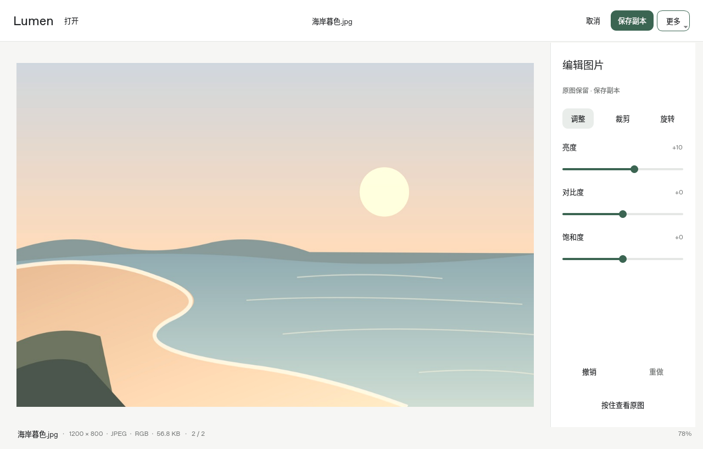
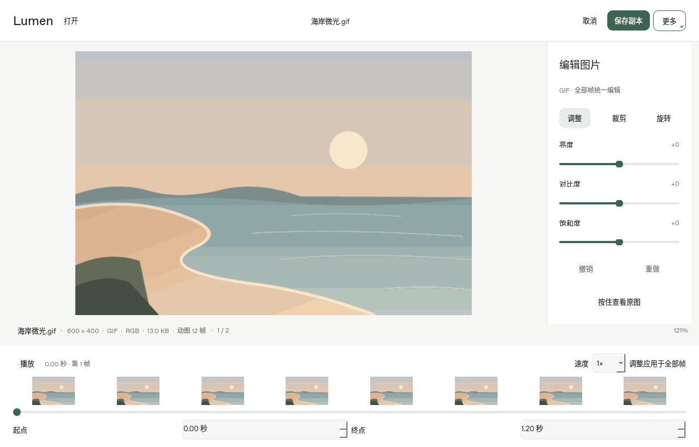

# Lumen View

轻量的 Windows 图片查看与编辑器。Python + Qt 原生界面，无浏览器运行时；跟随系统浅色／深色外观，默认以图片为主，进入编辑后再显示工具。


## 浏览与编辑

- JPEG、PNG、GIF、WebP、AVIF、HEIC、JXL、TIFF、PSD、SVG、相机 RAW 等格式。
- 滚轮缩放、拖动平移、前后翻页、全屏和幻灯片。
- 点击“编辑”或按 `Ctrl+E`：亮度、对比度、饱和度、旋转、水平翻转。
- 裁剪支持原始比例、1:1、16:9、4:5，以画面中心裁剪。
- 撤销／重做，按住查看原图；取消编辑还原原图。
- 保存副本支持 JPEG、PNG、WebP；所有编辑均不修改原图。



## GIF 编辑



- 时间轴预览、逐帧定位、首尾片段截取、0.5×／1×／1.5×／2× 调速。
- 对选中片段的全部帧统一应用裁剪、旋转、翻转、调色。
- 导出 GIF 或动画 WebP，保留帧时长和循环次数。
- 转成静态格式时，可选择当前帧或第一帧。
- GIF 仅支持 256 色和二值透明；半透明效果推荐导出动画 WebP。
- GIF 编辑预览按需生成，不预先复制整段编辑后的动画；复杂画面的预览帧率取决于处理速度，导出按设定时长编码。

## Windows 启动

需要 **64 位 Python 3.12**。仓库不包含 `.pylibs` 依赖目录，首次使用先安装：

```powershell
py -3.12 tools/fetch_libs.py
.\LumenView.cmd
```

安装器调用 pip，读取固定版本的 `requirements.txt`，失败返回非零状态。依赖安装到项目内 `.pylibs`。

或创建独立开发环境：

```powershell
py -3.12 -m venv .venv
.venv\Scripts\python -m pip install -e . pytest
.venv\Scripts\python -m lumenview "D:\photos\photo.gif"
```

`LumenView.exe` 为独立启动器，不包含 Python 与 Qt。修改后的启动器源码会探测项目内 Python 或系统 Python 3.12，不使用开发者个人路径。**仓库原有 EXE 尚未替换**；请先使用 CMD，或构建新启动器：

```powershell
& "$env:WINDIR\Microsoft.NET\Framework64\v4.0.30319\csc.exe" /target:winexe /out:LumenView.exe /win32icon:LumenView.ico /r:System.Windows.Forms.dll tools/LumenView.cs
```

GitHub Actions 的 Windows 检查会编译启动器并上传构建产物。

## 快捷键

| 操作 | 快捷键 |
| --- | --- |
| 打开图片／文件夹 | Ctrl+O / Ctrl+Shift+O |
| 前后翻页 | ← / → / 空格 |
| 编辑／保存副本 | Ctrl+E / Ctrl+Shift+S |
| 撤销／重做 | Ctrl+Z / Ctrl+Shift+Z |
| 旋转／翻转 | R / Shift+R / H |
| 适应窗口／实际大小 | 0 / 1 |
| 缩略图栏／全屏／幻灯片 | Tab / F11 / F5 |

## 验证

```powershell
python -m pytest -q
python tools/ui_test.py
python tools/selftest.py
```

测试覆盖静态调色和透明度、GIF／动画 WebP 往返、片段时长、循环次数、原图保护、原子保存失败恢复，以及真实 Qt 窗口中的编辑与后台导出。GitHub Actions 配置 Linux／Windows 两个平台检查。

## 当前边界

- 第一版不含自由拖动裁剪框、文字、涂鸦、逐帧绘画或增删帧。
- 未做 ICC 色彩管理和 HDR 显示，专业印前／色彩校对请使用专门软件。
- 多页 TIFF 当前显示第一页；SVG 静态渲染，最长边 2048px。
- Pillow／PSD／RAW 主图限制 6400 万像素，动画解码预算 256 MiB；超出时提示错误，不静默截断动画。
- 文件夹最多 5000 张；缩略图按可见区域加载，缓存最多 128 张。
- Windows 启动器未签名；本地 Linux 验证不能替代 Windows 真机安装和交互验收。

## 代码结构

- `modern.py`：现代界面、编辑状态、时间轴和后台任务。
- `editing.py`：可撤销操作参数、图像变换、GIF 时长处理、原子导出。
- `window.py` / `canvas.py`：原生窗口、异步解码、画布与浏览能力。
- `decoders.py` / `filmstrip.py`：格式分发和按需缩略图。

## 第三方组件

- [PySide6](https://www.qt.io/) — LGPL / 商业双许可
- [Pillow](https://python-pillow.org/) — HPND
- [pillow-heif](https://github.com/bigcat88/pillow_heif) — BSD-3-Clause（libheif / libde265 / x265）
- [pillow-jxl-plugin](https://github.com/Isotope-Labs/pillow-jxl-plugin) — BSD-3-Clause（libjxl）
- [psd-tools](https://github.com/psd-tools/psd-tools) — MIT
- [rawpy](https://github.com/letmaik/rawpy) — MIT（libraw）
