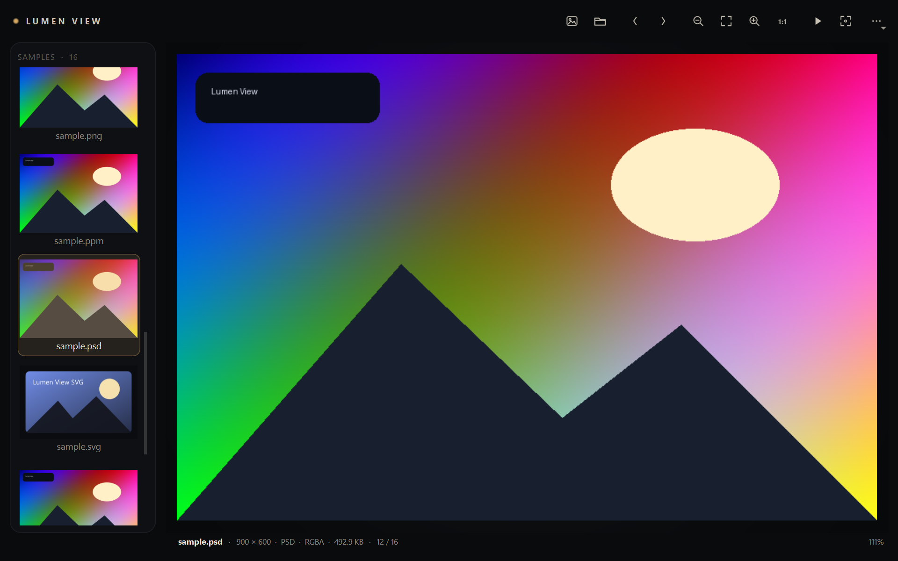
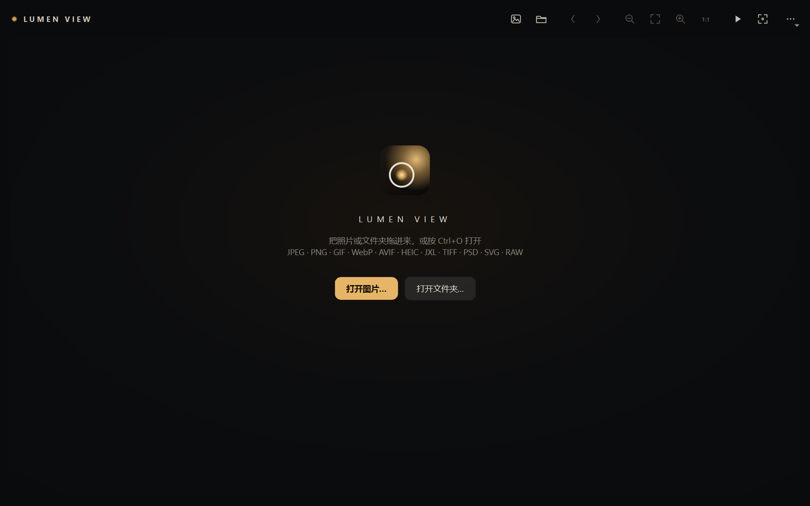

# Lumen View

轻量、本地优先、格式管够的 Windows 看图软件。**Lumen** 系列第三件作品，和 [Lumen Mark](https://github.com/zkangping-glitch/lumen-mark)（Markdown）一脉相承：成熟底座 + 薄定制层，双击就能用。

照片在前，界面退后。



## 它解决什么

Windows 11 自带的「照片」打不开 PSD / SVG / JXL / RAW，HEIC 还要装扩展。Lumen View 把这些解码器收进同一个进程，双击就能看：

| 类别 | 格式 |
| --- | --- |
| 常见位图 | JPEG / PNG / APNG / GIF（动图）/ BMP / ICO / TIFF（多页） |
| 现代格式 | **WebP（动图）/ AVIF / HEIC / HEIF / JPEG XL** |
| 专业格式 | **PSD / PSB（合成图 + 图层数）**、**SVG（矢量，2048px 渲染）**、JPEG 2000、TGA、PCX、PPM 系列、DDS、SGI、XBM |
| 相机 RAW | **CR2 / CR3 / NEF / ARW / DNG / ORF / RAF / RW2 / PEF / SRW** 等 30 余种（libraw） |

## 界面

- **暖金 + 炭黑**：品牌色 `#E6B567`，底色 `#0A0B0D`，只让选中态和主按钮发光。
- **原生深色标题栏**：通过 DWM 把标题栏、边框、圆角染成和内容区同色，窗口是一整块。
- **没有状态栏**：画布下方一行 26px 的信息带，左侧文件名 / 尺寸 / 格式 / 体积 / 序号，右侧缩放比例。
- **浮动缩略图卡**：208px 圆角卡片，离开画布 14px，`Tab` 收起。
- **安静动效**：切图 180ms 淡入；缩放以光标为锚点；全屏只留照片。



## 功能

| 功能 | 说明 |
| --- | --- |
| 打开 | `Ctrl+O` 文件、`Ctrl+Shift+O` 文件夹、命令行参数、拖放文件/文件夹 |
| 浏览 | 左侧缩略图（后台线程池，JPEG 走 draft、PSD/RAW 读内嵌预览）、`←`/`→` 翻页 |
| 缩放 | 滚轮以光标为中心、`Ctrl+=` / `Ctrl+-`、`0` 适应窗口、`1` 实际大小、双击切换 |
| 变换 | `R` / `Shift+R` 旋转、`H` 水平翻转（只改显示，不动原文件，会话内记忆） |
| 动图 | GIF / WebP / APNG / 动图 JXL 按帧播放 |
| 幻灯片 | `F5`，3 秒一张，循环 |
| 全屏 | `F11`，`Esc` 退出；进入全屏自动隐藏所有 chrome |
| 其他 | 复制图片、资源管理器定位、交给系统默认应用打开、窗口大小记忆 |

## 快速开始

```powershell
# 1) 双击 LumenView.exe（78 KB 启动器，无控制台，可被“打开方式”识别）
# 2) 或 LumenView.cmd（纯脚本后备）
# 3) 或命令行
python -m lumenview "D:\photos\IMG_0001.HEIC"
```

依赖已解包在 `.pylibs/`（PySide6、Pillow、pillow-heif、pillow-jxl-plugin、psd-tools、rawpy），
运行时通过 `PYTHONPATH` 注入，不污染系统 Python。需要 **Python 3.12**。

换机器或删了 `.pylibs` 时重新拉取（自带的小型 wheel 安装器，不依赖 pip）：

```powershell
python tools/fetch_libs.py
```

## 快捷键

| 操作 | 快捷键 |
| --- | --- |
| 打开图片 / 文件夹 | `Ctrl+O` / `Ctrl+Shift+O` |
| 上一张 / 下一张 | `←` / `→`，`空格` 下一张 |
| 适应窗口 / 实际大小 | `0` / `1`，双击画面切换 |
| 放大 / 缩小 | `Ctrl+=` / `Ctrl+-`，滚轮缩放 |
| 旋转 / 翻转 | `R` / `Shift+R` / `H` |
| 缩略图栏 | `Tab` |
| 幻灯片 / 全屏 | `F5` / `F11`，`Esc` 退出 |

## 结构

```
LumenView/
├─ lumenview/
│  ├─ __main__.py      # 入口
│  ├─ window.py        # 主窗口：顶栏、页脚、快捷键、异步解码调度、DWM 染色
│  ├─ canvas.py        # QGraphicsView：缩放/平移/旋转/翻转/动图/淡入/画布渐变
│  ├─ filmstrip.py     # 浮动缩略图卡，QThreadPool 后台生成
│  ├─ decoders.py      # 格式分发：Pillow / QtSvg / psd-tools / rawpy / pillow-heif
│  ├─ icons.py         # 全部图标和品牌 mark 用 QPainter 画，零图片资源
│  └─ theme.py         # 设计 token + 全局 QSS
├─ tools/
│  ├─ fetch_libs.py    # 从 PyPI 拉 wheel 并解包到 .pylibs
│  ├─ make_samples.py  # 生成 16 种格式的测试图
│  ├─ make_icon.py     # 渲染 LumenView.ico
│  ├─ LumenView.cs     # 78 KB C# 启动器源码（csc 编译）
│  ├─ selftest.py      # 无头解码回归（16 种格式）
│  ├─ ui_test.py       # 驱动真实窗口的 24 项交互测试
│  └─ shot.py          # 截图（支持 --fullscreen）
├─ samples/            # 测试图
├─ docs/               # 截图
├─ LumenView.exe       # 启动器
├─ LumenView.cmd
└─ requirements.txt
```

## 设计 token（改皮肤从这里开始）

`lumenview/theme.py`：

| token | 值 | 用途 |
| --- | --- | --- |
| `BG` | `#0A0B0D` | 窗口底色 |
| `SURFACE` | `#0F1114` | 缩略图卡 |
| `TEXT` | `#ECE6DA` | 正文（暖白） |
| `MUTED` | `#8E887C` | 次级信息 |
| `ACCENT` | `#E6B567` | 品牌暖金 |
| `ACCENT_SOFT` | `#241D12` | 选中底 |

字体：`Segoe UI Variable Text` → `Microsoft YaHei UI` → `Segoe UI`。
品牌字标是 9pt / 600 / 3.4px 字距的大写 `LUMEN VIEW`，前面一颗 9px 暖金光点（`icons.accent_dot`）。

## 架构

- **解码全在工作线程**：`QThreadPool` + token 版本号，快速翻页时旧结果自动丢弃。
- **QImage 在子线程构造**，回 UI 线程再转 `QPixmap`。
- **缩略图快路径**：JPEG `draft()`、PSD 内嵌预览、RAW 内嵌 JPEG。
- **旋转/翻转是显示变换**，不写回文件；视图状态在会话内按路径记忆。
- **所有图标程序化绘制**，没有 png/svg 资源，换色只改一个常量。

## 构建与测试

```powershell
$env:PYTHONPATH=".pylibs"

python -m compileall -q lumenview
python tools\make_samples.py     # 生成测试图
python tools\selftest.py         # 16 种格式解码回归
python tools\ui_test.py          # 24 项窗口交互测试（offscreen）
python tools\shot.py samples\sample.psd docs\screenshot.png
```

启动器（无需 .NET SDK，Windows 自带 `csc`）：

```powershell
csc /target:winexe /out:LumenView.exe /win32icon:LumenView.ico /r:System.Windows.Forms.dll tools\LumenView.cs
```

## 图标

当前 `icons.app_icon()` 是占位设计：炭黑圆角方块 + 暖色光晕 + 镜头圆环。

替换方式：

1. 设计一张 1024×1024 的方形 PNG（建议深底 + 暖金光）；
2. 覆盖 `icons.app_icon()` 的绘制，或直接改成加载 `docs/icon.png`；
3. `python tools/make_icon.py` 重新生成 `LumenView.ico`；
4. 重新编译 `LumenView.exe`，任务栏/标题栏图标会自动更新。

## 交接给 Codex / 后续开发

| 入口 | 位置 |
| --- | --- |
| 窗口骨架、顶栏、页脚、快捷键、异步调度 | `lumenview/window.py` |
| 画布（缩放/平移/变换/动图/渐变） | `lumenview/canvas.py` |
| 缩略图卡与线程池 | `lumenview/filmstrip.py` |
| 格式分发与解码器 | `lumenview/decoders.py` |
| 视觉 token / QSS | `lumenview/theme.py` |
| 图标与品牌 mark | `lumenview/icons.py` |
| 回归测试 | `tools/selftest.py`、`tools/ui_test.py` |
| 截图回归 | `tools/shot.py` |

调试入口：`tools/shot.py` 可传任意图片并加 `--fullscreen`；`tools/ui_test.py` 输出逐项 PASS/FAIL，可直接当回归基线。

## 已知限制

- SVG 只渲染静态图；EXR、DICOM、JPEG XR 尚未支持。
- 16-bit / HDR 图会压到 8-bit 显示，未做 ICC 色彩管理。
- 单张超过约 2 亿像素可能吃满内存。
- 文件夹列表上限 5000 张、缩略图上限 1500 张。
- `.pylibs` 是 cp312 / win_amd64 二进制，换 Python 版本需要重新 `fetch_libs.py`。
- `LumenView.exe` 未签名，首次运行 SmartScreen 会提示“未知发布者”。

## 第三方组件

- [PySide6](https://www.qt.io/) — LGPL / 商业双许可
- [Pillow](https://python-pillow.org/) — HPND
- [pillow-heif](https://github.com/bigcat88/pillow_heif) — BSD-3-Clause（libheif / libde265 / x265）
- [pillow-jxl-plugin](https://github.com/Isotope-Labs/pillow-jxl-plugin) — BSD-3-Clause（libjxl）
- [psd-tools](https://github.com/psd-tools/psd-tools) — MIT
- [rawpy](https://github.com/letmaik/rawpy) — MIT（libraw）

---

Lumen View 由 DeepSeek Harness 会话内的 AI 协作开发，延续 Lumen Mark 的技术取向：成熟底座 + 薄定制层。
